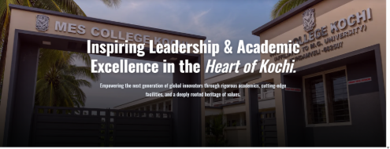
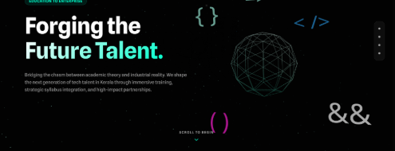
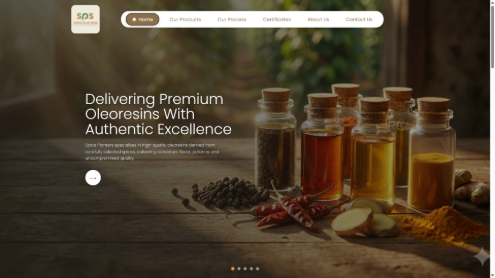
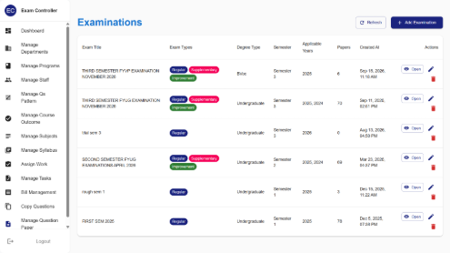

<table width="100%">
<tr>
<td width="38%" align="center" valign="middle">

<h1 align="center"><b>ANANDHU S</b></h1>

</td>
<td width="62%" valign="middle">

<h3><b>FULL STACK ENGINEER</b></h3>

<b>MSc in Artificial Intelligence</b> &nbsp;•&nbsp; <b>2.5+ Years of Industry Experience</b>

Building scalable web applications, mobile apps and enterprise ERP systems, 
from UI to database to deployment.

&nbsp;

</td>
</tr>
</table>

---

## About

I'm a full stack developer who builds real products for real organizations: college websites, corporate sites, an examination platform and a multi-module college ERP.

I own features end to end: **requirements** → **React frontend** → **Node.js APIs** → **database** → **deployment**. With an MSc in AI, I'm also interested in bringing intelligent features into everyday business software.

---

## Featured Projects

<table width="100%">
<tr>
<td width="48%" align="center" valign="middle">
  
</td>
<td width="52%" valign="middle">

### [MES College Kochi](https://www.mes-kochi.org/)

Dynamic institutional portal serving students, faculty, and administration with real-time academic announcements, event scheduling, and departmental operations.

- **Highlights:** Dynamic admin CMS, responsive UI, secure REST endpoints
- **Stack:** `React` `Node.js` `Express` `MySQL`

  <a href="https://www.mes-kochi.org/"><b>Live Site ↗</b></a>

</td>
</tr>

<tr>
<td width="48%" align="center" valign="middle">
  
</td>
<td width="52%" valign="middle">

### [Cellar Innovative Developers](https://www.cellarinnovative.dev/)

Immersive 3D interactive corporate website engineered for modern digital branding with smooth WebGL animations and responsive architecture.

- **Highlights:** Interactive 3D graphics, fluid micro-interactions, responsive design
- **Stack:** `React` `JavaScript` `3D Web` `CSS3`

  <a href="https://www.cellarinnovative.dev/"><b>Live Site ↗</b></a>

</td>
</tr>

<tr>
<td width="48%" align="center" valign="middle">
  
</td>
<td width="52%" valign="middle">

### [Spice Planters](https://www.spiceplanters.com/)

Responsive corporate business platform featuring structured product cataloging, customer inquiry pipelines, and optimized cloud delivery.

- **Highlights:** Product showcases, customer inquiry pipelines, fast API integration
- **Stack:** `React` `JavaScript` `REST APIs` `CSS`

  <a href="https://www.spiceplanters.com/"><b>Live Site ↗</b></a>

</td>
</tr>

<tr>
<td width="48%" align="center" valign="middle">
  
</td>
<td width="52%" valign="middle">

### [QP Solution](https://www.qpsolutions.in/login)

Intelligent question bank and examination paper generation suite built for autonomous colleges with algorithmic paper balancing.

- **Highlights:** Role-based authorization, PDF generation, question taxonomy
- **Stack:** `React` `Node.js` `Express` `MySQL`

  <a href="https://www.qpsolutions.in/login"><b>Live Portal ↗</b></a> &nbsp;•&nbsp; <i>Confidential client project</i>

</td>
</tr>
</table>

### College ERP Platform &nbsp; 

A unified ERP for managing college operations with role-based access across 15+ modules.

<b>View all modules</b>

 

- **Academics & Curriculum:** Syllabus planning, course outcomes, timetables
- **Student Information System:** Admissions, enrollment, attendance, student profiles
- **Examinations & Grading:** Internal marks, exam scheduling, grade sheets, transcripts
- **Finance & Fees:** Fee structure configuration, dues tracking, receipt generation
- **Faculty & HR:** Staff directory, leave management, workload allocation
- **Administration & Portals:** Role-based access control (RBAC), audit logs, department dashboards

---

## Tech Stack

| | |
| :--- | :--- |
| **Frontend** |        |
| **Backend** |     |
| **Databases** |   |
| **Hosting & Cloud** |    |
| **Dev Tools** |     |
| **AI-Assisted Dev** |     |
| **Design** |   |

---

## What I Bring

| | |
| :--- | :--- |
| **End-to-end ownership** | UI, APIs, database design and deployment |
| **Complex systems** | Multi-role platforms with many modules and permissions |
| **Production experience** | Live products used by real organizations |
| **AI foundation** | MSc in AI, keen to build intelligent features |
| **Modern workflow** | AI-assisted development for faster, cleaner delivery |

---

### Let's Connect

 

&nbsp;

